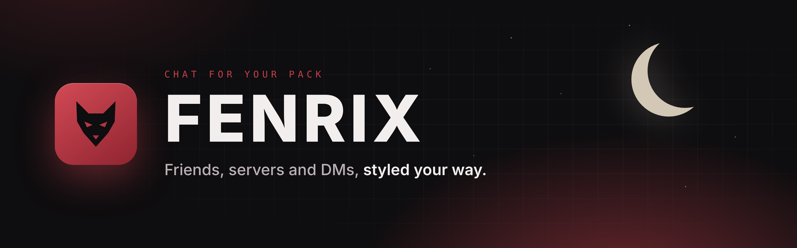
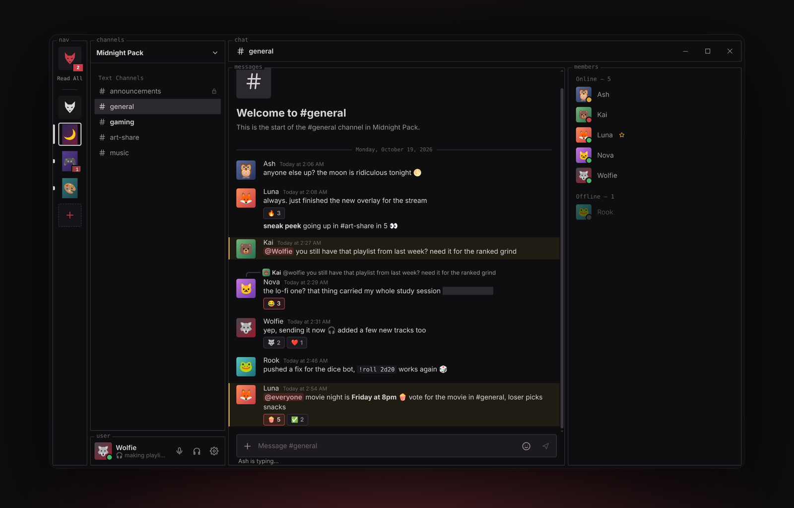
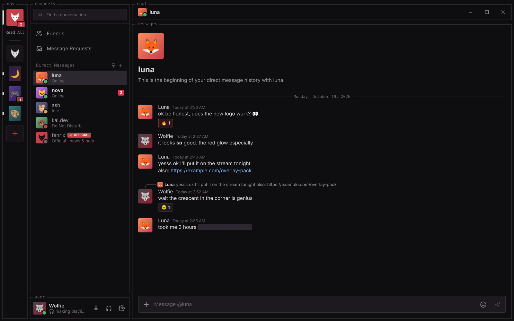
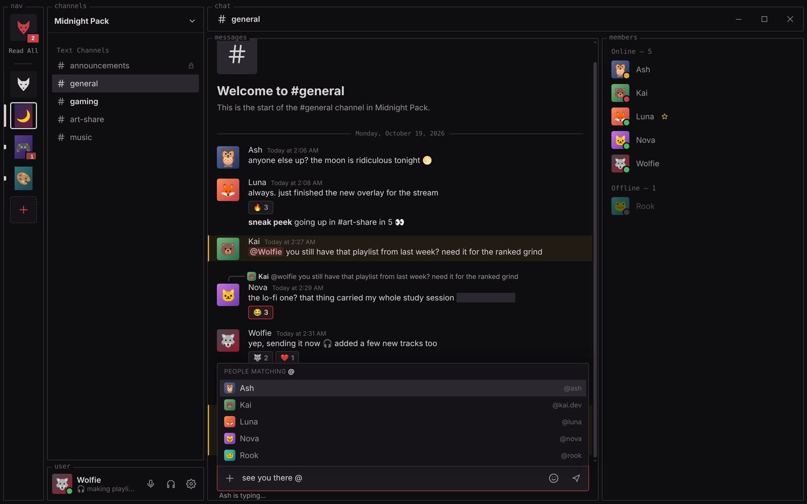
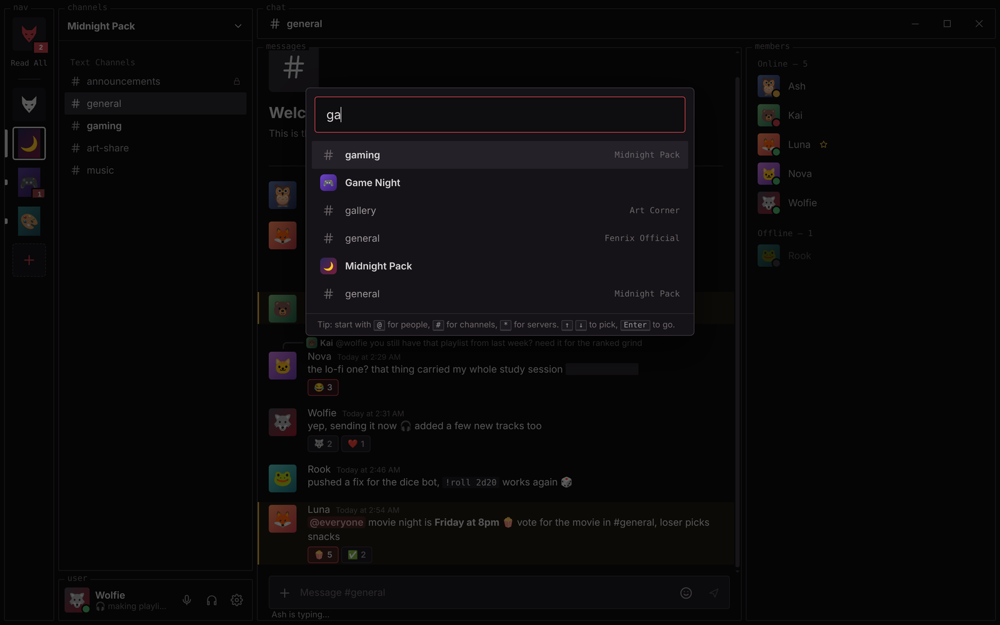
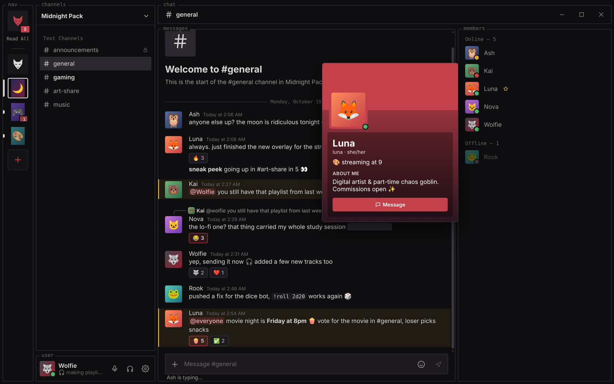
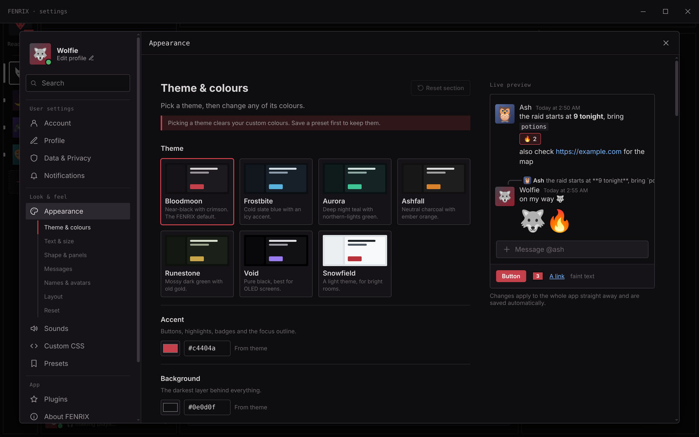
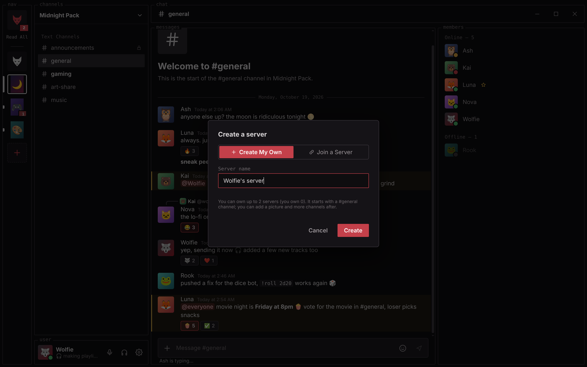
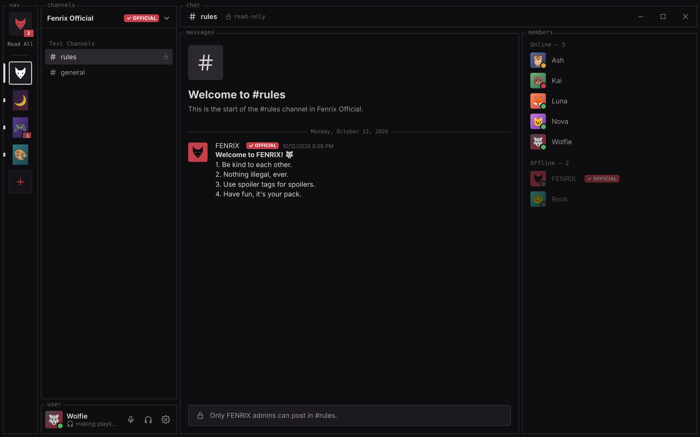

 

### A desktop chat app for you and your friends: servers, DMs, and a look that's entirely yours.

  

 

## ✨ Highlights

<table>
<tr>
<td width="50%" valign="top">

### 🐺 Servers for your pack
Create your own server, give it a name and a picture, add channels, and invite friends
with a short code. Make channels **read-only** for announcements, and see who's online in
the members list.

</td>
<td width="50%" valign="top">

### 💬 Real-time messages
DMs and channels update **live**, with replies, reactions, edits, pictures, videos and
files up to 25 MB. You also get markdown, **spoilers**, `code`, links, custom emoji, and
*"Luna is typing…"*.

</td>
</tr>
<tr>
<td width="50%" valign="top">

### 🔔 @mentions that matter
Type `@` to mention someone. Mentions of you are highlighted and get a red badge, and only
mentions make a sound in servers. Server owners can call `@everyone` for the big
announcements.

</td>
<td width="50%" valign="top">

### 🎨 Make it yours
**7 themes** (Bloodmoon, Frostbite, Aurora, Ashfall, Runestone, Void, Snowfield), plus your
own colours, fonts, spacing and sounds. Save looks as presets and share them, or go all in
with **custom CSS** and plugins.

</td>
</tr>
<tr>
<td width="50%" valign="top">

### ⚡ Fast to get around
Press <kbd>Ctrl</kbd> + <kbd>K</kbd> to jump to any friend, server or channel by typing part
of its name. Use <kbd>Alt</kbd> + <kbd>↑</kbd> / <kbd>↓</kbd> to move through channels.
Pin your favourite friends, and group servers into folders.

</td>
<td width="50%" valign="top">

### 🔄 Always up to date
FENRIX **updates itself**. New versions download quietly in the background, and a
**Restart to update** button appears when they're ready. Every download is checked against
a SHA-512 fingerprint.

</td>
</tr>
</table>

 

## 📸 Tour

<table>
<tr>
<td width="50%"></td>
<td width="50%"></td>
</tr>
<tr>
<td align="center"><b>Direct messages</b> Replies, reactions, links, spoilers and online status</td>
<td align="center"><b>@mentions</b> Type <code>@</code> and pick someone from the list</td>
</tr>
<tr>
<td width="50%"></td>
<td width="50%"></td>
</tr>
<tr>
<td align="center"><b>Quick switcher</b> <kbd>Ctrl</kbd> + <kbd>K</kbd>, type, <kbd>Enter</kbd></td>
<td align="center"><b>Profiles</b> Picture, banner, pronouns, status, bio and theme colours</td>
</tr>
<tr>
<td width="50%"></td>
<td width="50%"></td>
</tr>
<tr>
<td align="center"><b>Appearance</b> Themes, colours, fonts and a live preview</td>
<td align="center"><b>Your own servers</b> Create one, or join with an invite code</td>
</tr>
</table>

Screenshots show an invented demo community. No real people or messages.

 

## 📥 Install

1. **[Download the latest `FENRIX-Setup-x.y.z.exe`](https://github.com/kiritogod001/fenrix-releases/releases/latest)** (under *Assets*).
2. Open it. FENRIX installs in a few seconds, with **no admin password needed**, and adds
   desktop and Start menu shortcuts.
3. Create an account with an email, a username and a password. You'll find yourself in
   **Fenrix Official**, the server everyone shares.
4. Add friends by their username: **Friends → Add Friend**.

> [!NOTE]
> **"Windows protected your PC"?** Windows shows this for apps that aren't code-signed
> (signing costs hundreds of dollars a year, and FENRIX is free). Click **More info → Run
> anyway**. You'll only see this on the first install, not for updates.

**Requirements:** Windows 10 or 11 (64-bit) and an internet connection.

 

## 🔄 Updates

You don't need to download anything again. FENRIX checks for a new version when it starts
and every 30 minutes, then downloads it in the background. When the green **Restart to
update** button appears in the title bar, click it, or just keep chatting: the update
installs the next time you close FENRIX. **Settings → About FENRIX → Updates** shows your
version and lets you check right away.

 

## ⌨️ Keyboard shortcuts

| Shortcut | What it does |
|---|---|
| <kbd>Ctrl</kbd> + <kbd>K</kbd> | Jump to a person, server or channel |
| <kbd>Alt</kbd> + <kbd>↑</kbd> / <kbd>↓</kbd> | Previous / next channel or conversation |
| <kbd>Ctrl</kbd> + <kbd>/</kbd> | Show all shortcuts |
| <kbd>↑</kbd> in an empty message box | Edit your last message |
| <kbd>Ctrl</kbd> + <kbd>B</kbd> / <kbd>I</kbd> / <kbd>U</kbd> | Bold / italic / underline |
| <kbd>Shift</kbd> + <kbd>Enter</kbd> | New line |
| <kbd>Ctrl</kbd> + <kbd>Shift</kbd> + <kbd>R</kbd> | Safe mode: reset the look if a theme or CSS went wrong |

 

## 🔒 Privacy & safety

- **Encrypted in transit.** Everything travels over HTTPS. Messages are *not* end-to-end
  encrypted.
- **What's stored online:** your account, profile, friends, and the messages and files you
  send, so they reach your friends. Your password is stored scrambled and can't be read
  back, even by the FENRIX team.
- **Moderation:** to keep FENRIX safe and remove illegal content, **the FENRIX admin can read
  DMs** and can mute or ban accounts.
- **Your controls:** block anyone, appear **Invisible**, and delete your account (with your
  pictures and files) from **Settings → Account**.
- **On your PC:** **Settings → Data & Privacy** lists everything FENRIX keeps on your computer.

 

## ❓ FAQ

<b>Is FENRIX free?</b>

 
Yes. No ads, no subscriptions.

<b>Can I use more than one account?</b>

 
Yes. Click your name at the bottom left, then <b>Switch Accounts</b>. You can keep up to 5 accounts signed in.

<b>How many servers can I create?</b>

 
You can own up to 2 servers for now, and join as many as you like (up to 100).

<b>Does FENRIX have voice and video calls?</b>

 
Not yet. Voice, video and screen sharing are next on the roadmap.

<b>Something isn't working. What should I do?</b>

 
First, make sure you have the latest version (<b>Settings → About FENRIX → Updates</b>).
If it still happens, message the official <b>FENRIX</b> account in your DMs. If FENRIX can't
open at all, the file <code>logs\fenrix.log</code> in <code>%APPDATA%\FENRIX</code> helps track down the problem.

<b>My look got messed up after editing CSS or a theme.</b>

 
Press <kbd>Ctrl</kbd> + <kbd>Shift</kbd> + <kbd>R</kbd>. That puts the appearance back to default and switches off custom CSS and plugins. Your old settings are kept, so it can be undone.

 

## 🗺️ Roadmap

- [x] Accounts, friends and real-time DMs
- [x] Profiles, pictures and file sharing
- [x] Servers, channels, invites and owner tools
- [x] @mentions, typing indicators and the quick switcher
- [x] Automatic updates
- [ ] Voice and video calls
- [ ] Screen sharing

 

  

**Made with 🐺 for the pack.**

FENRIX is an independent project and isn't affiliated with Discord.

